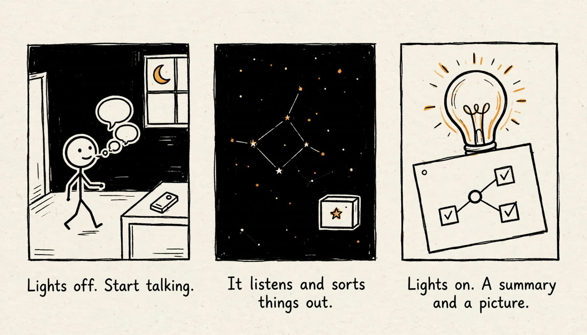
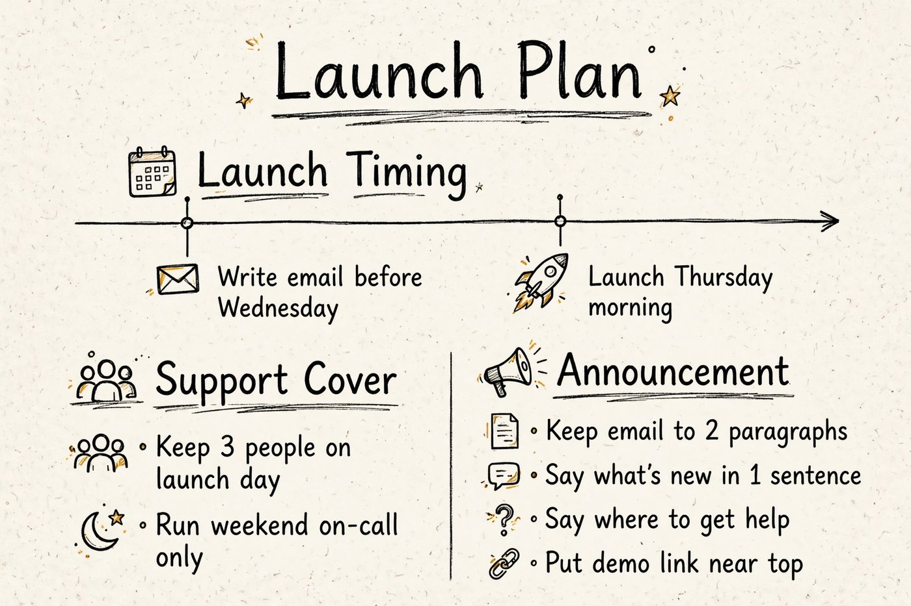

# Blackout

Think it through without looking at a screen.

You state a goal, press Lights off, and think out loud while the screen stays black. Blackout listens, stays quiet by default, and returns a cited summary, a mind map, decisions, todos, and a hand-drawn picture when you finish.



Demo video: https://github.com/huangfe9/blackout-think/releases/download/v1.0/blackout_demo.mp4 (recorded live against the real API; the voices are computer speech) · Replay with no key and no install: https://huangfe9.github.io/blackout-think/app/static/example.html

## What it does

- You type or speak a goal and press Lights off. The screen goes pure black.
- You think out loud. No key presses are needed.
- It stays quiet and builds a mind map from what you say.
- When you drift off the goal, it parks the idea and brings you back in one sentence.
- If you say "please look up...", it searches in the background and reports back in one spoken sentence.
- If a fact you stated changes, it asks which version holds.
- After a long quiet stretch, it gives one short status line.
- Say "Stop" and the light comes on. The summary is read aloud.
- If anything goes wrong, it says so out loud.
- A second window, the star map, shows the mind map growing. It is for a second screen or a video.
- It works in English and Chinese.

## What you get



This is real output from a fictional talk, not a mock-up. You get a short summary, a clean mind map, decisions, todos, open questions, parked ideas, and unresolved tensions. Every decision, todo, and question can be opened to show the exact words it came from. If you said you needed to write something, a first draft is included. A one-page hand-drawn picture is drawn from the checked summary.

## Run it

You need Python 3.10 or newer, Chrome or Edge, a microphone, and your own Meta Model API key from https://dev.meta.ai/api-keys/ .

```bash
git clone https://github.com/huangfe9/blackout-think
cd blackout-think
pip install -r requirements.txt
python start.py
```

A browser opens and asks for your key. A key in `.env` or in the environment also works. See `.env.example`. If you use `.env`, keep the project out of cloud-synced folders such as OneDrive or Dropbox, because the key would be uploaded with it. The page stores the key outside the project instead.

## Your key and your words

- The key is saved in `%LOCALAPPDATA%\Blackout\api_key` on Windows or `~/.blackout/api_key` elsewhere, outside the repository.
- It gets owner-only permissions where the system supports them. Anyone with access to your computer user account can still read the file, as with any local credential.
- The key is checked with Meta before it is saved. It is sent only to `api.meta.ai`.
- No route returns the key, not even masked. The browser does not keep it. Logs redact it.
- Only the computer running the server can set, change, or delete it, and only from the app's own page.
- Anyone who can run programs as you on this computer can use the running app, as with any local tool, but cannot read the key back from it.
- Use a key with a spending limit set in Meta's billing page if you can.
- Paid calls come from your own Meta account. They stop at `BLACKOUT_STOP_AT_USD`, default $10 and at most $140, enforced locally by `budget.py`.
- A short talk of about 25 sentences costs about $0.20, including the search, the draft, and the picture. A longer talk costs more in proportion.
- Speech and text go only to the Meta Model API. Sessions are saved on your own computer and can be deleted from the past sessions list.
- There are no accounts. Nothing is sent to the author.

## How it differs from a voice assistant

- Silence is the default. Most turns get no reply, only a quiet tick.
- It tracks the whole line of thought against your goal, not one question at a time.
- Drift is parked, not followed into a new conversation.
- It ends with one page whose items trace back to your exact words.

## Measured behaviour

These numbers are from `docs/evals.md`, run 2026-11-02 on the final code. They are fictional talks typed through the same code path as real speech, skipping only speech recognition. Simple rules scored them. They measure behaviour, not whether the product helps people.

8 fictional talks, 124 lines in total. The AI spoke on 31 lines and made 0 unasked interruptions. Pull-backs: 8 of 8. Changed facts asked about: 7 of 8. Look-ups started: 8 of 8. Decisions found: 8 of 10. Todos: 8 of 8. Open questions: 6 of 8. Parked items: 8 of 8. Both talks that called for a draft got one, and 4 other talks with a writing todo also got an unasked draft. Median turn was about 4.2 seconds. Average cost was $0.12 per talk of 15 to 17 lines, including search and draft, with no picture. A picture adds $0.01 plus a short check.

Real paid evaluations can be run with `python -m tests.evals.run_evals`. The normal test suite makes no paid calls.

## How it uses Meta models

- `muse-voice-transcribe-1.0` hears you. It runs over a realtime connection in hands-free mode, and transcribes uploaded audio for the push-to-talk fallback and goal dictation.
- `muse-spark-1.3` runs each turn. It returns a strict structured decision and additions to the mind map.
- `muse-spark-1.3` with `web_search` does background look-ups. Without tools, it writes background drafts and reads photos of paper sketches.
- `muse-spark-1.3` does the final pass. It reads every utterance and returns the summary, the clean mind map, decisions, todos, and open questions, each citing the utterances it came from.
- `muse-image-1.0` draws the one-page hand-drawn picture from the checked summary. One picture costs $0.01.
- `muse-spark-1.3` then reads the picture back to check its text. Text in a picture can still come out wrong. The picture can be redrawn.
- Only Spark, Voice, and Image run in the product. See "Contributors and how this was built" for the models that generated the code.

## How it works

- `app/conductor.py` decides each turn: listen, follow up, pull back, answer, or start background work. Silence is the default.
- `app/realtime.py` bridges the browser microphone to the realtime speech API and separates the AI's echo from real speech by comparing text.
- `app/summary.py` runs the final pass and drops any item whose citations do not match a numbered utterance.
- `app/poster.py` plans the picture, asks `muse-image-1.0` to draw it, and has Spark read it back to check the text.
- `app/keys.py` saves, checks, and redacts the API key. No route returns it.
- `budget.py` is the local hard spending limit. It records each paid call and refuses calls past the cap.
- There are no accounts. A browser owns its sessions through a cookie, and only a hash of that cookie is stored.
- Sessions are one JSON file each on your computer, saved after every turn.

## On a phone

Run `python -m app.phone` and open the printed address on a phone on the same Wi-Fi. It serves HTTPS with a self-signed certificate and an access token, because phones need HTTPS for the microphone. The phone will warn about the certificate once. This has not yet been tried on a physical phone.

## Limits

- It needs a quiet-enough place to talk aloud.
- It has not been tried by anyone except the author. No effectiveness claims are made.
- It is a thinking tool, not a treatment for attention problems. It gives no health advice.
- The end-to-end browser flow has been run on Windows with Chrome. macOS and Linux run the automated tests in CI only.
- A physical phone has not been tested.
- Speech output uses the browser's voice. Quality varies by device.
- Text in a generated picture can still come out wrong despite the check. It can be redrawn.
- It is not built for public hosting. That would need per-visitor spending limits and data expiry.
- Multiple speakers are not told apart.
- Clearing browser cookies loses access to past sessions, because there are no accounts.

## Contributors and how this was built

Only human contributor: huangfe9 (GitHub), who had the idea, made the product decisions, and tried it.

Muse Spark and Muse Wonder, through the Meta Model API, generated the code, tests, and docs. Of these, only `muse-spark-1.3` is also used by the running product, along with `muse-voice-transcribe-1.0` and `muse-image-1.0`. `muse-wonder-1.0` is not used at run time. Raw model output is in `muse_runs/` and the prompts are in `spec/`.

Claude Code (Anthropic's coding agent) drafted the prompts from the author's idea, ran the generation, reviewed and tested the output, wrote throwaway test scripts that are not in this repository, assembled the demo video from a real recording, and made the commits. Security reviews by Claude Code produced findings that Muse then fixed.

This public repository starts from a clean commit. Earlier development happened in a private repository during the event.

## 中文说明

Blackout 是一个不用看屏幕的思考工具。
输入今天的目标，按下关灯，屏幕变黑。
你直接说出想法，它默认安静地听，并整理成思维导图。
说偏了，它会先记下，再把你带回目标。
说"帮我查一下"，它会在后台搜索，只说一句结论。
说"结束"，灯亮起来，你会得到摘要、决定、待办和一张手绘图。
每一条都能点开，看到它来自你的哪句原话。
运行：git clone https://github.com/huangfe9/blackout-think，然后 cd blackout-think，pip install -r requirements.txt，python start.py。
需要你自己的 Meta Model API key，费用从你的账户扣除。

## License

MIT. See `LICENSE`.
